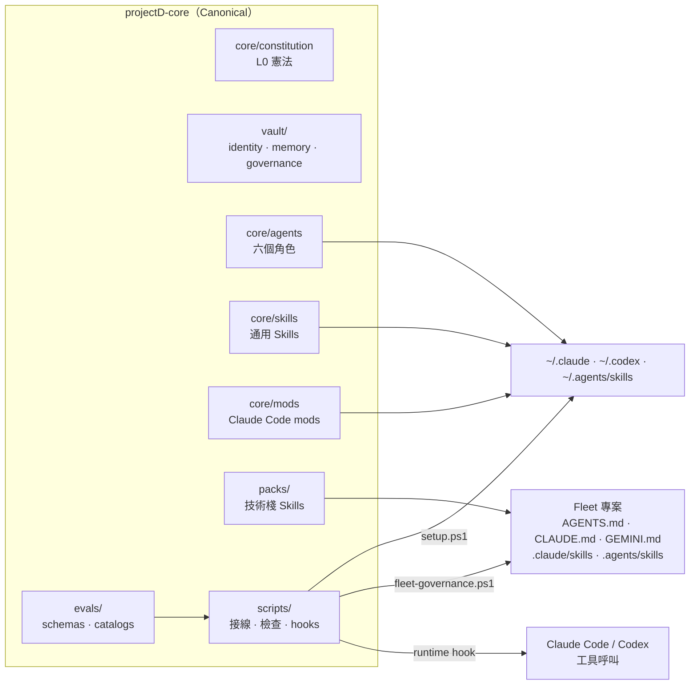
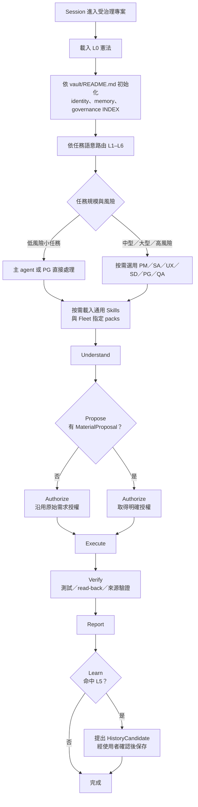

# projectD-core

個人擁有、provider-neutral、按需載入的 AI 治理核心。

一份 repository 同時管理：AI agent 要遵守的規則（L0 憲法＋L1–L6 路由）、可重用的
Skills、依技術棧選用的 packs、把這些規則接到 Claude Code／Codex 與各專案的接線工具，
以及在工具呼叫當下執行授權判斷的 runtime hook。Canonical 內容只在本 repository 維護，
其他地方都是 junction、受管區塊或複本。

> 使用者：OliverMing（全端工程師，同時維護 5–8 個不同技術棧的專案）。
> 授權：All Rights Reserved，見 [`LICENSE`](LICENSE)。

## 設計原則

- **L0 永遠最高**：任何 agent、pack、Skill、command 都不能覆寫
  [`core/constitution/rules.md`](core/constitution/rules.md)。
- **按需載入**：session 啟動只讀少量入口（上限 10 KiB），其餘規則、Skills、packs、
  歷史都在命中任務時才讀。
- **技術生態中立**：不把特定工具、框架或供應商寫成全域唯一答案；技術選擇依專案證據。
- **證據優先**：contract／synthetic 測試通過不等於真實模型或 live hook 已驗證；
  宣稱要有可回讀的證據。
- **多層保護互不取代**：L0 授權、runtime hook、pre-push hook、CI、Review 各自獨立。

## 架構總覽



| 層 | 放什麼 | 怎麼到 AI 手上 |
|---|---|---|
| L0 憲法 | 10 條跨專案最高原則 | 每個 session 開始時讀 |
| Vault | 使用者檔案、短工作記憶、L1–L6 路由 | 依 [`vault/README.md`](vault/README.md) init 序列讀 |
| 角色 | PM／SA／UX／SD／PG／QA | `setup.ps1` 複製到 `~/.claude/agents/` |
| 通用 Skills | 工作流、審查、設計、工具 | junction 到 `~/.claude/skills/` 與 `~/.agents/skills/`，全域可發現 |
| 技術棧 packs | C#、React、Angular、Python… | 只由 Fleet 接到指定專案，不進全域 catalog |
| Runtime hook | 每次工具呼叫的授權判斷 | 本 repo 的 [`.claude/settings.json`](.claude/settings.json) 與 [`.codex/hooks.json`](.codex/hooks.json) |

## Session 與任務流程



## 治理模型

### L0 憲法（摘要）

全文見 [`core/constitution/rules.md`](core/constitution/rules.md)。

1. 高風險操作必須授權（刪除、改寫歷史、force push、正式環境、部署、對外傳送）。
2. 最小必要改動。
3. 證據優先、禁止靜默猜測。
4. 安全與秘密不妥協。
5. 驗證結果必須誠實。
6. 角色邊界清楚。
7. 技術規則按需載入（細節在 `packs/`）。
8. 制度按真實需求演進。
9. 跨專案治理保持技術生態中立。
10. 重要判斷保留可追溯理由。

### L1–L6 路由

Session 只常駐 [`vault/governance/INDEX.md`](vault/governance/INDEX.md) 的摘要；命中時才讀
[`operating-model.md`](vault/governance/operating-model.md) 的對應段落。

| 層級 | 命中情境 | 最小原則 |
|---|---|---|
| L1 安全 | 秘密、權限、檔案、網路、外部整合、部署、不可逆操作 | 分清 Source／Action；高風險先授權 |
| L2 判斷 | 架構、根因、影響、重大取捨 | 分開事實與假設，以專案證據驗證 |
| L3 流程 | 多步驟、多檔案、跨模組、行為變更 | TaskScopedProposalLoop；TDD；雙軸 Review |
| L4 技能 | 工作流、工具、技術棧 | 既有專案決策優先；Skills／packs 按需 |
| L5 經驗 | 歷史決策、重複踩坑 | 摘要只作索引，回讀原始證據 |
| L6 校準 | 準備交付 | read-back、測試或來源驗證；缺口明說 |

具體情境範例：[需求驅動開發路由](vault/governance/requirement-driven-routing.md)
（需求書開發、功能維護、Debug 三條主線）。

### TaskScopedProposalLoop

`Understand → Propose → Authorize → Execute → Verify → Report → Learn`

- 只處理使用者提出或授權範圍內的工作；不做背景監控、不自行擴張範圍。
- 只有會影響正確性、安全、資料、權限、可觀察行為、架構、維運或阻塞的發現才算
  MaterialProposal；格式、命名、非必要重構不算。
- 原始需求內低風險、可回復的步驟沿用授權；擴張範圍、新依賴、跨 repo、對外傳送、
  高風險操作需明確授權。
- 只有命中 L5 條件才提出 HistoryCandidate，經使用者確認才保存。

### 角色

六個角色是可選能力，不是固定流水線。定義在 [`core/agents/`](core/agents/)。

| 角色 | 何時用 |
|---|---|
| `pm` | 需求或成功條件不清楚 |
| `sa` | 技術影響、整合、技術棧選擇不清楚 |
| `ux` | 使用者互動流程或易用性取捨未定 |
| `sd` | 有實質架構、資料模型、介面取捨 |
| `pg` | 實作、審查、測試 |
| `qa` | 複雜、高風險或使用者可見變更需要獨立驗證 |

小型任務由主 agent 或 PG 直接處理；中型任務先短計畫再按需用角色；大型任務才走
PM → SA → UX → SD → PG（→ QA）。

## Skills 與 Packs

目前有 39 個通用 Skills（`core/skills/`）與 9 個技術棧 packs（`packs/`）。用途與觸發
時機見 [Skill 總目錄](docs/operations/skill-catalog.md)；行為規則以各自的 `SKILL.md` 為準。

| 類別 | Skills |
|---|---|
| 規劃、研究與交付 | `grilling`、`grill-with-docs`、`research`、`prototype`、`domain-modeling`、`manage-requirement-knowledge`、`to-questionnaire`、`to-spec`、`to-tickets`、`wayfinder`、`query-project-history`、`implement`、`minimal-implementation-ladder`、`agent-team-gate`、`handoff`、`pr` |
| 審查 | `code-review`、`security-review` |
| 程式結構與除錯 | `codebase-design`、`improve-codebase-architecture`、`codegraph`、`diagnosing-bugs` |
| UI、視覺與動效 | `animation-vocabulary`、`apple-design`、`design-engineering`、`find-animation-opportunities`、`improve-animations`、`review-animations`、`select-frontend-capability`、`show-me`、`visual-direction`、`gpt-image-2-style-library`、`archify` |
| Skill 治理 | `skill-scout`、`skill-update-check`、`writing-great-skills` |
| 帳號與內部系統 | `claude-switch-account`、`tfs`、`tfs-code` |

| Pack | 範圍 |
|---|---|
| `csharp` | C#、ASP.NET Core、.NET Framework、ESOAF 平台慣例 |
| `frontend-core` | Framework-neutral HTML、CSS、無障礙、互動 |
| `frontend-react` | React component、hook、state、測試 |
| `frontend-angular` | 現代 Angular（Signals、RxJS、forms、routing） |
| `frontend-angularjs` | AngularJS 1.x 維護與漸進遷移 |
| `typescript` | TS／JS、module system、build tool |
| `node-runtime` | Node.js 服務、CLI、process lifecycle |
| `python` | Python automation、Web backend、資料處理 |
| `rdl-report` | F25B ESOAF 家族 SSRS RDL 報表 |

`packs/_staging/` 是不可信、不可載入的審查區。外部 Skill 的來源、版本與採用狀態集中在
[`vault/governance/skill-registry.json`](vault/governance/skill-registry.json)；引入流程見
[ADR 0016](docs/adr/0016-targeted-skill-intake.md)。

## Runtime 治理（工具呼叫守門）

在本 repo 裡工作的 Claude Code 與 Codex，每次工具呼叫前都會經過
[`scripts/governance-host-operation-hook.ps1`](scripts/governance-host-operation-hook.ps1)
與 [`scripts/governance-command-policy-hook.ps1`](scripts/governance-command-policy-hook.ps1)。

核心規則：**host 的權限提示不等於 projectD 的任務授權。**

| 操作 | 例子 | 結果 |
|---|---|---|
| `local-read`／`network-read` | Read、Glob、Grep；`git status/log/diff`、`ls`、`cat`；`codegraph query`；`gh pr view` | 放行（advisory，只記錄） |
| 有副作用的操作 | Write、Edit、一般 shell 指令、`git commit/push`、MCP 寫入 | 沒有授權 envelope 就在執行前拒絕 |
| 無法分類的操作 | 未知工具、Agent、多數 MCP | 永遠拒絕，授權也不能放行 |

Shell 指令會拆成片段逐一比對唯讀清單；任何片段不在清單內，或含 `>`、`<`、反引號、
`$(...)`，整條指令就不算唯讀。`git -C <path> ...` 目前不在清單內。

### 發一張任務授權

授權只能由使用者在**自己開的互動式終端機**發出；agent 無法自己發，redirect 的 stdin
會被拒絕。

```powershell
pwsh -NoProfile -File scripts/governance-task-authorization.ps1 `
  -HostName claude `
  -Capability workspace-write `
  -TargetClass workspace-file `
  -ExpiresInMinutes 30 `
  -ExplicitUserAuthorization
```

接著照提示親手輸入 `AUTHORIZE claude workspace-write workspace-file`。

- 授權綁定同一個 session、同一份 policy digest，最長 24 小時。
- 改到 policy 相關檔案會讓所有現有授權立即失效（防止 agent 邊改規則邊放寬自己）。
- `-CapabilitySet governance-dev` 一次授權三組常用的非對外、非破壞性權限。
- `production-mutate` 與任意 `command-execute` 需另加 `-AllowExternal`／`-AllowDestructive`，
  不能用 capability set 取得。
- 決策與證據只存 metadata，寫在 `.local/governance/`（Git 不追蹤）。

完整契約見 [Agent Runtime Governance](docs/specs/agent-runtime-governance.md)；Codex 的實機
驗證步驟見 [Codex Live Pilot](docs/operations/runtime-governance-v2-codex-live-pilot.md)。

## 安裝與接線

Git 只同步 Canonical 內容。`PROJECTD_CORE`、全域 junction、`fleet/fleet.json`、`.local/`
都是每台電腦各自的本機狀態；換電腦後要重新接線。

所有 desired-state 操作都先檢查 ownership／conflict，不屬於 projectD 的檔案不會被覆寫，
途中失敗會回滾本次異動。

### 全域接線

```powershell
pwsh -File scripts/setup.ps1 -Mode Check   # 唯讀檢查
pwsh -File scripts/setup.ps1               # 套用
```

`setup.ps1` 會：

- 設定使用者環境變數 `PROJECTD_CORE`；
- 複製 `core/agents/*.md` 到 `~/.claude/agents/`、`core/commands/*.md` 到 `~/.claude/commands/`；
- 把每個 `core/skills/*` junction 到 `~/.claude/skills/` 與 `~/.agents/skills/`；
- 把 `core/mods/*` junction 到 `~/.claude/mods/`；
- 在 `~/.claude/CLAUDE.md` 與 Codex 的 `AGENTS.md`（`$CODEX_HOME` 或 `~/.codex`）寫入受管區塊。

Mods 還要手動在 `~/.claude/settings.json` 設定 `CLAUDE_CODE_PLUGIN_DIRS`，見
[`core/mods/README.md`](core/mods/README.md)。

### Fleet：專案範圍接線

```powershell
pwsh -File scripts/fleet-inspect.ps1                    # 安全預檢
pwsh -File scripts/fleet-governance.ps1 -Mode Apply     # 套用
pwsh -File scripts/fleet-governance.ps1 -Mode Check     # 唯讀驗證
```

依 [`fleet.json.example`](fleet/fleet.json.example) 建立本機 `fleet/fleet.json`（不進 Git），
為每個專案寫 `path`、`category`（`work`／`side`）與 `packs`。Fleet 會在專案的
`AGENTS.md`、`CLAUDE.md`、`GEMINI.md` 寫入受管區塊，並只把指定 packs 接到
`.agents/skills/` 與 `.claude/skills/`。Fleet 不會遞迴掃描 workspace 或其他 repo。
詳見 [`fleet/README.md`](fleet/README.md)。

### 移除

```powershell
pwsh -File scripts/uninstall.ps1 -Mode Check
pwsh -File scripts/uninstall.ps1
```

## 檢查與 CI

```powershell
pwsh -File scripts/projectd-check.ps1                    # 一般品質閘門
pwsh -File scripts/projectd-check.ps1 -GovernanceEvals   # 加上 11 項 governance checks
pwsh -File scripts/projectd-check.ps1 -Json
python -m pytest tests/
```

- 一般檢查：Skill catalog／registry、session-init 與 Skill discovery 預算、staging
  生命週期、CI 去重、Fleet catalog、文字掃描、接線，以及各工具的 contract tests。
- `-GovernanceEvals` 再跑：structural eval、behavior catalog、asset inventory、security
  trace replay、Claude run-plan、host hook、host trial、upgrade gate、operation log、
  orphaned log reconciliation、runtime policy。全部是 deterministic／offline。
- 可選 pre-push hook：`pwsh -File scripts/governance-hooks.ps1 -Mode Install`。
- CI（[`.github/workflows/governance-check.yml`](.github/workflows/governance-check.yml)）：
  `secret-scan`（TruffleHog）與 `repository-governance`，每個 PR 都跑。
- 換行規則以 `.gitattributes` 為準（文字檔 LF、BAT／CMD checkout 為 CRLF）。

詳細說明見 [治理接線與驗證手冊](docs/operations/governance-workflow-and-checks.md)。

## 周邊工具

| 工具 | 做什麼 | 文件 |
|---|---|---|
| Token 用量監控 | 本機收集 Codex／Claude 每回合 token 與額度，可去識別化匯出、跨裝置合併、出報表 | [操作手冊](docs/operations/token-usage-monitoring.md) |
| Codex 狀態列 | Codex CLI footer 顯示模型、context 與額度 | [說明](docs/operations/codex-usage-status-line.md) |
| Claude Code mods | `statusbar` 狀態列、`open-todos` 跨 session 待辦面板 | [說明](core/mods/README.md) |
| Claude 帳號切換 | 安全切換工作／個人訂閱帳號 | [說明](docs/operations/claude-account-switching.md) |
| 每日最小用量 ping | 平日 09:30 讓 Codex／Claude 各回一次 OK，不碰專案內容 | [說明](docs/operations/scheduled-min-usage-ping.md) |
| 專案歷程搜尋 | 可選的本機歷程索引；一般 setup 不會安裝 | [移機說明](core/skills/query-project-history/references/portable-setup.md) |
| KnowledgeWorkspace | 知識內容在獨立的 `projectD-knowledge`；core 只留查詢與需求 adapter | [核心邊界](docs/specs/knowledge-workspace-boundary.md) |
| DevSpace 隔離容器 | rootless container＋egress 白名單 proxy 的 MCP 執行框架 | [安全邊界](docs/specs/devspace-security-boundary.md)、[容器](containers/devspace-isolation/README.md) |

## 目錄

| 路徑 | 用途 |
|---|---|
| `core/constitution/` | L0 憲法 |
| `core/agents/` | 六個可選角色 |
| `core/commands/` | Claude 相容 commands |
| `core/skills/` | 通用 Skills |
| `core/mods/` | Claude Code 介面 mods |
| `packs/` | 技術棧 Skills；`_staging` 不可信、不可載入 |
| `vault/` | identity、工作記憶、L1–L6 治理、Skill registry、after-action |
| `fleet/` | Fleet 說明與範例清單 |
| `scripts/` | 接線、檢查、runtime hooks、用量工具、contract tests |
| `evals/` | Governance JSON schemas、catalogs、fixtures |
| `tests/` | Python contract tests |
| `docs/adr/` | 架構決策紀錄（[索引](docs/adr/README.md)） |
| `docs/specs/` | 現行規格 |
| `docs/operations/` | 操作手冊（[索引](docs/operations/README.md)） |
| `containers/devspace-isolation/` | DevSpace 隔離容器 |
| `.local/` | 本機狀態、ledger、授權、log；Git 不追蹤 |

術語定義見 [`CONTEXT.md`](CONTEXT.md)；開發流程見 [`CONTRIBUTING.md`](CONTRIBUTING.md)；
安全回報見 [`SECURITY.md`](SECURITY.md)；變更紀錄見 [`CHANGELOG.md`](CHANGELOG.md)。

## 目前狀態與邊界

- Governance Evals Phase 1–2 已完成。Phase 3 有 contracts、adapters、logs、hooks、gates
  與 bounded single-host 證據；live runner、observers、broader pilots、paired
  authorization、Copilot 與 cross-host matrix 尚未完成。
- Runtime Governance v2：2026-09-04 在 Codex 與 Claude 各完成一次 bounded single-host
  實機驗證（read 放行、授權後 workspace write 放行、未授權指令拒絕）。之後的唯讀分類
  放寬（2026-09-06 shell 唯讀清單與 dry-run、2026-10-20 `gh` 讀取、2026-11-06
  `codegraph` 查詢）改變了 policy digest，只有 contract 測試，尚未重新做實機驗證；
  當時「`git status` 被拒絕」的證據已不代表現行規則。
- Recovery、crash／reopen、observer 與其他模型／工具路徑尚未實機驗證。
- Copilot 尚未接上 `setup.ps1` 或 runtime hook。
- 本機 runtime state 外移到 `PROJECTD_STATE_HOME`／`PROJECTD_CACHE_HOME` 已核准設計，
  尚未實作（[規格](docs/specs/external-runtime-state.md)）。
- Pi runtime 不屬於 mandatory core，只能是 optional adapter。

## 瘦身護欄

- Session init 總量不得超過 10 KiB。
- 全域 Skill discovery metadata 不得超過 6,000 characters。
- `_staging` 不保存 adopted／rejected 候選的完整工作副本。
- CI 不得在 individual steps 與 aggregate check 重跑同一重型 contract。
- 沒有使用或品質證據時，不因名稱相似大量刪除專門 Skills 或 safety evals。

## 文件索引

- 治理：[INDEX](vault/governance/INDEX.md)、[L1–L6 運作模型](vault/governance/operating-model.md)、[需求驅動開發路由](vault/governance/requirement-driven-routing.md)
- 規格：[Agent Runtime Governance](docs/specs/agent-runtime-governance.md)、[Governance Evals v2](docs/specs/governance-evals-v2.md)、[Phase 3](docs/specs/governance-evals-v2-phase-3.md)、[Command policy hook](docs/specs/governance-command-policy-hook.md)、[Implement review gate](docs/specs/implement-review-gate.md)、[Token 用量監控](docs/specs/token-usage-monitoring.md)、[DevSpace 隔離框架](docs/specs/devspace-isolation-container-framework.md)
- 決策：[ADR 索引](docs/adr/README.md)
- 操作：[操作手冊索引](docs/operations/README.md)、[Skill 總目錄](docs/operations/skill-catalog.md)、[Codex hook 間歇失敗診斷](docs/operations/codex-hook-intermittent-failure-diagnostic.md)
- 外部：[KnowledgeWorkspace 正式規格](https://github.com/OliverMingHao1024/projectD-knowledge/blob/main/specs/external-knowledge-wiki.md)、[研究報告歸檔](https://github.com/OliverMingHao1024/projectD-knowledge/tree/main/research)
